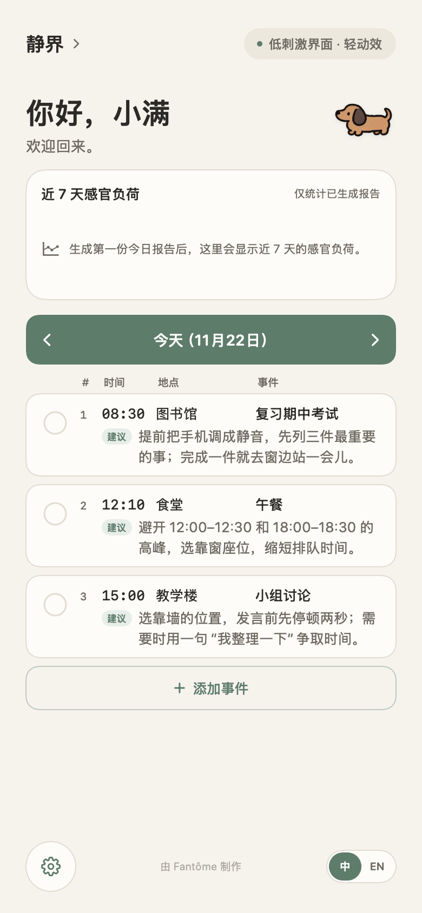
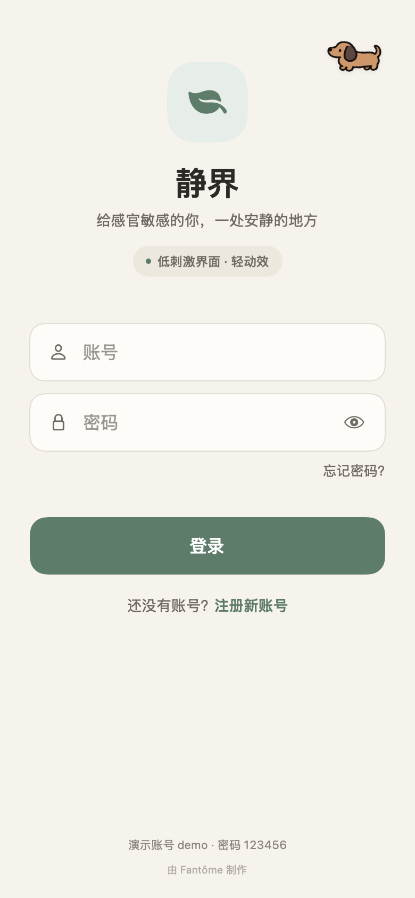
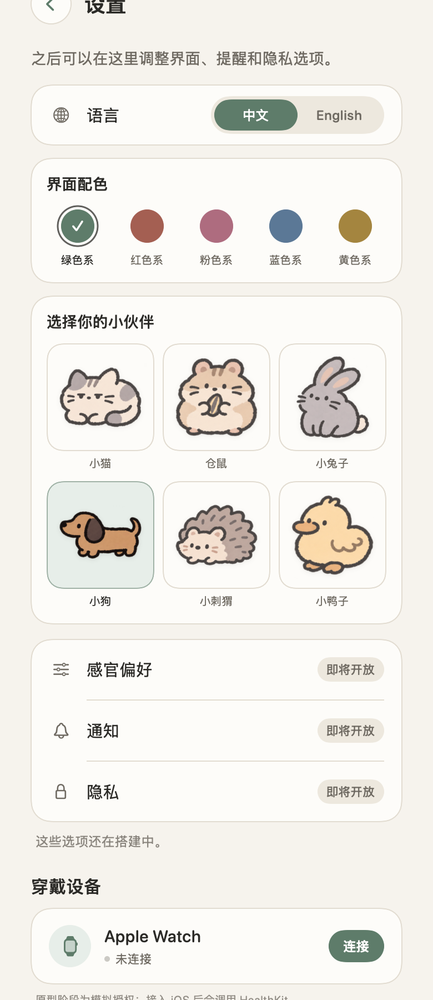
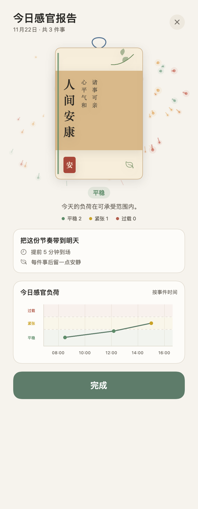
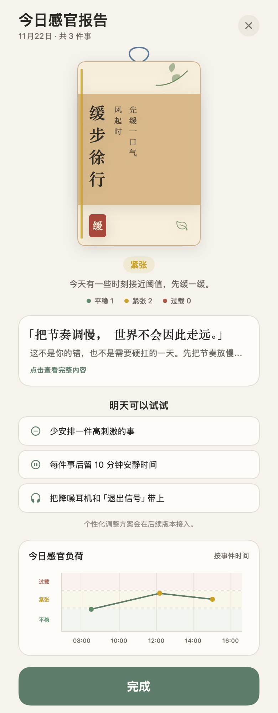
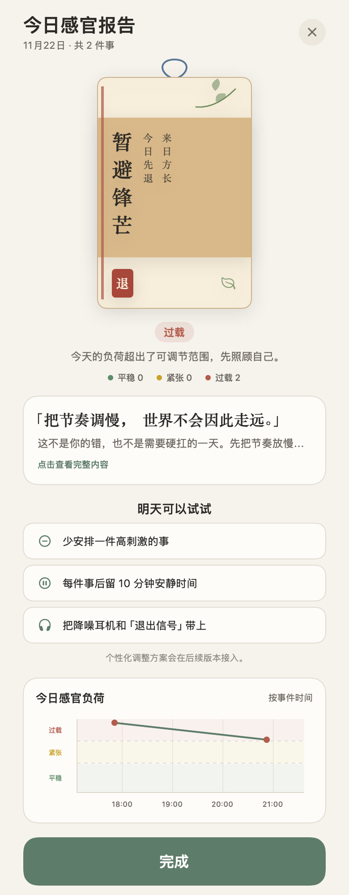
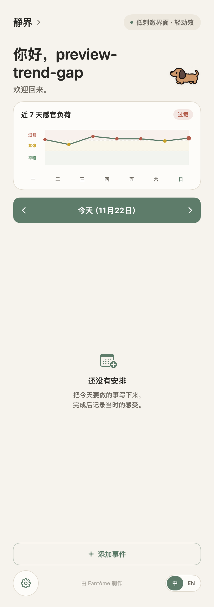
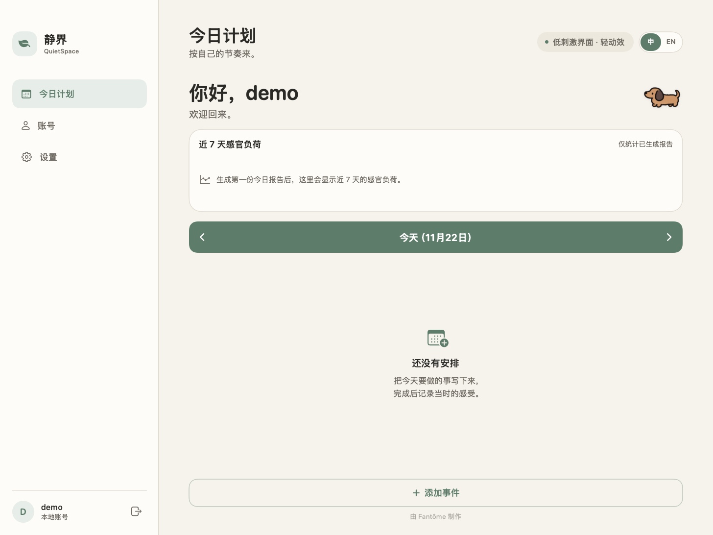

# 静界 QuietSpace

给感官敏感人群的低刺激日常支持原型。

感官自测 → 初步解决方案 → 每日计划 → 感官报告。  
用 SwiftUI 编写，同一套界面在窄窗口下是手机布局，在桌面宽窗口下自动变成带侧边栏的电脑版。

- 演示账号：`demo` / `123456`
- 平台：macOS 14+
- 架构：Universal（Apple Silicon + Intel）
- 语言：中文 / English
- 数据：全部保存在本机 `UserDefaults`，没有后端、没有网络请求



## 下载

[QuietSpace-0.1-macOS.zip](https://cdn.jsdelivr.net/gh/ZFZ15/quietspace@main/download/QuietSpace-0.1-macOS.zip)

GitHub raw 备用：`https://github.com/ZFZ15/quietspace/raw/main/download/QuietSpace-0.1-macOS.zip`

## 快速运行

需要 macOS 14 或更高版本，以及 Command Line Tools（或完整 Xcode）。

```bash
./build.sh
open dist/静界.app
```

`build.sh` 会直接调用 `swiftc` 编译，不依赖 `.xcodeproj`。  
如果机器上只有完整 Xcode，脚本会自动通过 `xcrun` 查找 `swiftc` 和 macOS SDK。

运行逻辑测试：

```bash
./test.sh
```

当前共 **58 项检查**，覆盖账号、自测、每日计划、感官评分、区间、趋势、配色、小伙伴、删除与重置。

## 界面

| 登录 | 设置 |
| --- | --- |
|  |  |

| 平稳报告 | 紧张报告 | 过载报告 |
| --- | --- | --- |
|  |  |  |




## 功能

- 注册 / 登录 / 退出，本地账号，密码 SHA-256 存储
- 10 题感官自测、区间评分、初步解决方案、评估规则页
- Apple Watch 模拟授权（原型阶段）
- 每日计划：日期切换、添加事件、时间滚轮、场景建议
- 完成事件：平稳 / 紧绷 / 过载，短暂即时反馈
- 删除事件：鼠标悬停或左滑
- 今日感官报告：单事件 100 分负荷、三区间、中式书签
- 近 7 天感官负荷趋势
- 5 套界面配色、6 张小伙伴贴纸
- 中英文界面
- 账号页、重新评估感官
- 宽窗口自动切换桌面侧边栏布局

## 感官评分

每一个事件满分 100，分数代表感官神经负荷，不是情绪好坏：

- 基础刺激分：安静场景 38 / 一般 50 / 繁忙 65 / 强刺激 80
- 调节系数：平稳 0.55 / 紧张 1.0 / 过载 1.9
- 最终得分 = min(100, 基础分 × 调节系数)
- 0–39 平稳，40–69 紧张，70–100 过载；≥85 重度过载
- 当天只要出现一件重度过载，整体进入过载区

报告不显示分数，而是按区间显示一张中式书签：

- 平稳：人间安康 / 心平气和，诸事可亲
- 紧张：缓步徐行 / 风起时，先缓一口气
- 过载：暂避锋芒 / 今日先退，来日方长

## 代码结构

```
Sources/
  QuietSpaceApp.swift           App 入口、窗口配置
  RootView.swift                登录态、引导、桌面/手机自适应
  AppDelegate.swift             窗口尺寸迁移
  Theme.swift                   5 套配色、颜色与字体
  Models.swift                  问卷、事件、感官区间、评分
  AdviceEngine.swift            场景建议库
  AccountStore.swift            本地账号与密码哈希
  SessionStore.swift            档案、计划、报告、趋势持久化
  Localization.swift            英文资源直接查找
  Components.swift              通用输入框、按钮、署名
  IMEPlatformTextField.swift    中文输入法组词状态处理
  LoginView.swift / RegisterView.swift
  HomeView.swift / DesktopSidebar.swift / AccountView.swift
  SettingsView.swift            配色、小伙伴、通知、隐私、穿戴
  OnboardingFlowView.swift      自测流程
  SolutionReportView.swift / RuleView.swift
  WearableView.swift
  DailyPlanView.swift           日期、事件、添加、感受、删除
  DailyReportView.swift         感官报告、书签、烟花
  DailyMoodChart.swift          单日感官负荷图
  MoodTrendView.swift           近 7 天感官负荷
  BookmarkView.swift            中式书签
  Companion.swift               6 张小伙伴贴纸与动效
  DebugCapture.swift            开发期窗口截图
Tools/
  Icon.swift                    App 图标生成
  Snapshot.swift                界面截图工具
  StoreTest.swift               逻辑测试
Resources/
  en.lproj/Localizable.strings  英文文案
  zh-Hans.lproj/                中文回退
  companion-*.png               6 张伙伴贴纸
```

## 技术说明

- **纯 SwiftUI**，没有第三方依赖。
- 所有状态用 `@AppStorage` / `UserDefaults` 持久化；账号密码只存 SHA-256 哈希。
- 主题用 `QSPalette` 枚举 + CSS 之外的 SwiftUI Color 动态读取，切换后刷新根视图。
- `IMEPlatformTextField` 包装 `NSTextField`，用 `hasMarkedText()` 在中文组词时隐藏占位提示，避免候选字与提示重叠。
- `BookmarkView` 用竖排宋体、牛皮纸色、红色印章和挂绳绘制书签，不依赖图片资源。
- `Companion` 使用 6 张透明背景手绘贴纸，模板化加载，登录页/主页有轻微起伏动效；尊重系统「减弱动态效果」。
- `Snapshot.swift` 用 `ImageRenderer` 生成截图，不依赖屏幕录制权限。
- 构建产物为 Universal binary，最低 macOS 14。

## 已知限制

- 只支持 macOS；iOS / Android / HarmonyOS 需要单独迁移。
- Apple Watch 为模拟授权，未真正接入 HealthKit。
- 数据只在本机，不支持云同步。
- 原型使用 ad-hoc 签名，未做 Apple 公证。其他人首次打开时：
  - 右键 App → 打开；或
  - `xattr -dr com.apple.quarantine "/Applications/静界.app"`
- 没有 `.xcodeproj`：当前构建环境只有 Command Line Tools，`build.sh` 是正式构建入口。

## License

Source code is released under the **Apache License, Version 2.0**.  
See `LICENSE` and `NOTICE`. Third-party / AI-assisted disclosure is in `THIRD_PARTY.md`.

## 制作

由 Fantôme 制作 · Made by Fantôme  
静界 QuietSpace · 低刺激日常支持原型
